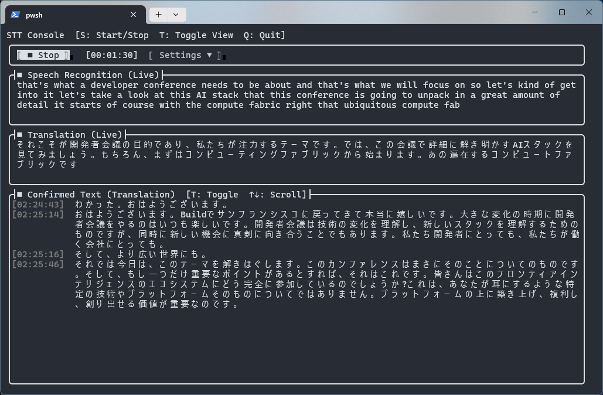

# STT Console

A terminal UI for real-time speech recognition and translation, powered by Azure AI Speech.
It shows live recognition and translation as you speak, and keeps a scrollable log of confirmed results.



*The audio in this screenshot comes from [a public YouTube video](https://www.youtube.com/watch?v=FFMm454fxNA&list=PLlrxD0HtieHicIn65R7Oi_1nFXQr4SbtU).

## Features

- Live speech recognition and live translation panes
- Confirmed-text pane that can toggle between recognized text and translated text
- Audio input selection
  - Windows: microphone or PC output (loopback) via WASAPI
  - Other platforms: the default microphone through the Speech SDK
- Source / target language selection
- Optional 2-pass recognition (`PostRefinement`)
- Two authentication methods
  - API key
  - Microsoft Entra ID sign-in (device code flow)
- Confirmed results are appended to a log file

## Requirements

- An Azure AI Speech resource (endpoint/region and either an API key or Entra ID access)

The release builds below include the .NET runtime, so nothing else needs to be installed.

## Download

Pushing a version tag (`v*`, for example `v1.0.0`) publishes a GitHub release with self-contained single-file builds that do not need the .NET runtime:

| Platform | Archive |
|---|---|
| Windows (x64) | `SttConsole-<version>-win-x64.zip` |
| Windows (Arm64) | `SttConsole-<version>-win-arm64.zip` |
| Linux (x64) | `SttConsole-<version>-linux-x64.tar.gz` |
| Linux (Arm64) | `SttConsole-<version>-linux-arm64.tar.gz` |
| macOS (Apple Silicon) | `SttConsole-<version>-osx-arm64.tar.gz` |

The macOS and Linux builds are not signed. On macOS, remove the quarantine attribute before the first run:

```bash
xattr -d com.apple.quarantine ./SttConsole
```

## Build and run

Building from source requires the [.NET 10 SDK](https://dotnet.microsoft.com/download).

```powershell
dotnet run --project src\SttConsole.csproj
```

## Usage

1. Open the settings dialogs from the top pane and configure:
   - **Audio input**: the device to capture from
   - **Speech service**: endpoint, region, and the authentication method
   - **Languages**: recognition source language and translation target language
   - **2Pass**: toggle post-refinement on or off
2. Press `S` (or the Start button) to start recognition. Press it again to stop.
3. Press `Q` or `Ctrl+C` to quit.

### Key bindings

| Key | Action |
|---|---|
| `S` | Start / stop recognition |
| `T` | Switch the confirmed-text pane between recognized and translated text |
| `Up` / `Down` | Scroll the confirmed-text pane by one line |
| `PageUp` / `PageDown` | Scroll the confirmed-text pane by one page |
| `Q` / `Ctrl+C` | Quit |

`Esc` is intentionally ignored so the app does not exit by accident.

## Speech service settings

Open **Speech Service Settings** to configure the connection. Values are saved to `settings.json` when you press OK.

### Common fields

| Field | Description | Example |
|---|---|---|
| Endpoint URL (optional) | Endpoint of your Speech resource. Leave it empty to connect through the region. Required for Entra ID sign-in when no Speech Resource ID is set (see below). | `https://my-speech.cognitiveservices.azure.com/` |
| Region | Azure region of the Speech resource. Required unless a full endpoint URL is used with an API key, and always required when a Speech Resource ID is set. | `japaneast` |
| 2-Pass Transcription | Turns on post-refinement of recognition results. | |
| Authentication | `API Key` or `Managed Identity` (see below). | |

The region is the short name shown in the Azure portal (for example `japaneast`, `eastus`, `westeurope`), not the display name (`Japan East`).

### Authentication: API Key

| Field | Description | Example |
|---|---|---|
| API Key | One of the keys on the **Keys and Endpoint** page of the Speech resource. The input is masked. | |

With an API key, the app connects to the endpoint URL if one is set, and to the region otherwise.
The simplest setup is therefore a region plus an API key.

### Authentication: Managed Identity (Microsoft Entra ID)

Despite its name in the dialog, this option signs in as a user with your own Entra ID account. It does not use an Azure managed identity.
Press **Sign In** in the dialog to authenticate. The status shows `Signed in` once it succeeds, and **Sign Out** clears the session.

| Field | Description | Example |
|---|---|---|
| Tenant ID | Directory (tenant) ID of the Entra ID tenant. | `00000000-0000-0000-0000-000000000000` |
| Client ID | Application (client) ID of an app registration in that tenant. | `00000000-0000-0000-0000-000000000000` |
| Redirect URI | Redirect URI for the browser sign-in. It must match one registered on the app registration. Defaults to `http://localhost:60916`. | `http://localhost:60916` |
| Speech Resource ID (Entra ID) | ARM resource ID of the Speech resource. See below. | `/subscriptions/<subscription-id>/resourceGroups/<resource-group>/providers/Microsoft.CognitiveServices/accounts/<speech-resource-name>` |
| Device Code Flow | Signs in by entering a code on another device or browser instead of opening a browser from the app. Useful over SSH or on a machine without a browser. | |

How the app connects with Entra ID depends on the Speech Resource ID:

- **Speech Resource ID set**: the app uses the Region together with the resource ID and sends an `aad#<resourceId>#<token>` authorization token to the Speech SDK. A custom domain is not required, and the Endpoint URL is ignored.
- **Speech Resource ID empty**: the app connects to the Endpoint URL with the Entra ID credential. The Speech resource must have a custom domain, and the Endpoint URL is required.

Setup on the Azure side:

1. Register an application in Microsoft Entra ID and add `http://localhost:60916` as a redirect URI on the **Mobile and desktop applications** platform.
2. If you use Device Code Flow, enable **Allow public client flows** on the app registration.
3. Grant the signed-in user a role that can call the Speech resource, such as **Cognitive Services Speech User**, on that resource.

You can find the resource ID on the Speech resource's **Properties** page in the Azure portal.

## Files written by the app

| Content | Windows | Linux | macOS |
|---|---|---|---|
| Settings (`settings.json`) | `%APPDATA%\SttConsole\` | `~/.config/SttConsole/` | `~/Library/Application Support/SttConsole/` |
| Entra ID authentication record (`auth-record.json`) | `%APPDATA%\SttConsole\` | `~/.config/SttConsole/` | `~/Library/Application Support/SttConsole/` |
| Confirmed recognition results (`recognition_*.log`) | `%TEMP%\sttconsole\logs\` | `/tmp/sttconsole/logs/` | `$TMPDIR/sttconsole/logs/` |

The log file is only created when there is at least one confirmed result.
Speech is sent to Azure while recognition is running, so stop recognition when you are not using it to avoid unnecessary charges.

## Platform notes

- The project targets `net10.0` and runs on Windows, Linux, and macOS.
- Capturing PC output (loopback) and choosing an audio device are Windows-only.
- On Linux, the Entra ID token cache may require `libsecret`.
- Recognition has been verified on Windows against a real Azure environment. On Linux the app starts and exits correctly, but recognition itself has not been verified.

## Project layout

```
src/
  Models/      Settings, language options, recognition result types
  Services/
    Settings/  Settings persistence
    Auth/      Entra ID sign-in
    Speech/    Azure Speech recognition and translation
    Audio/     Audio input abstraction (WASAPI / default microphone)
  UI/          Terminal.Gui main window and dialogs
  Program.cs   Entry point and dependency injection setup
docs/images/   Screenshots used in this README
```

## License

[MIT](LICENSE)
